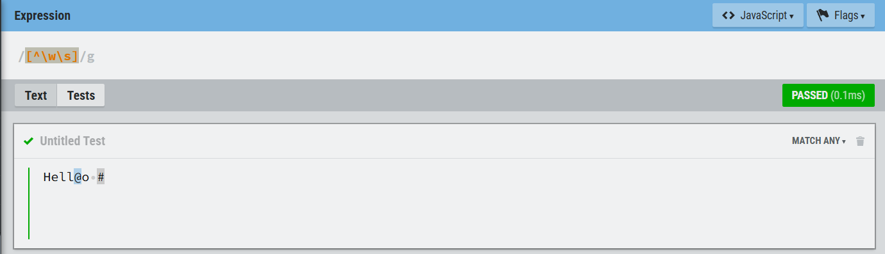
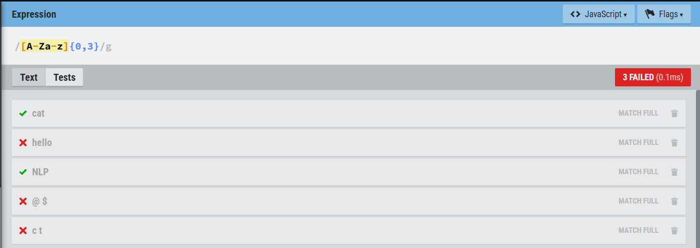
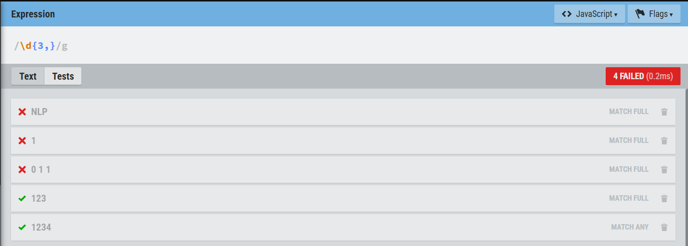
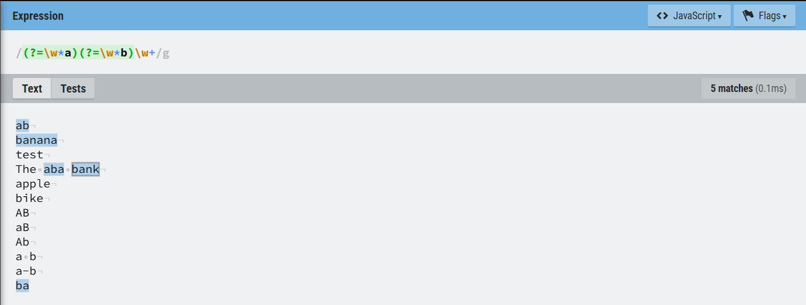
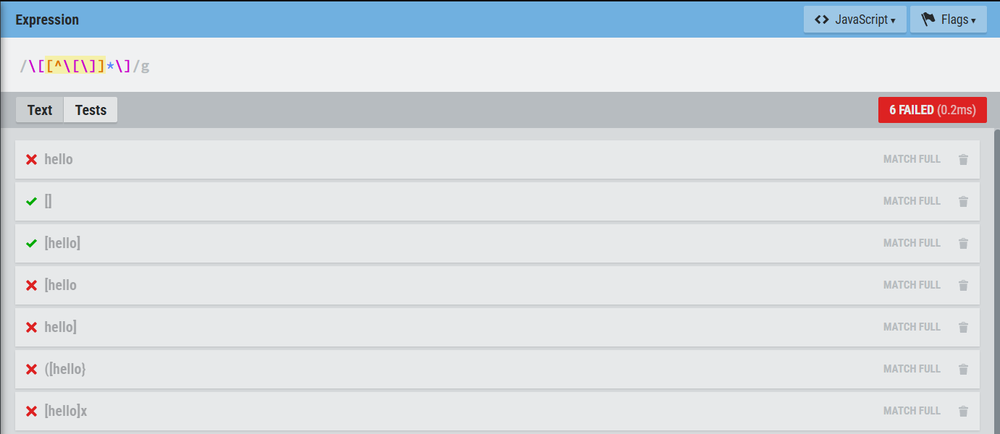
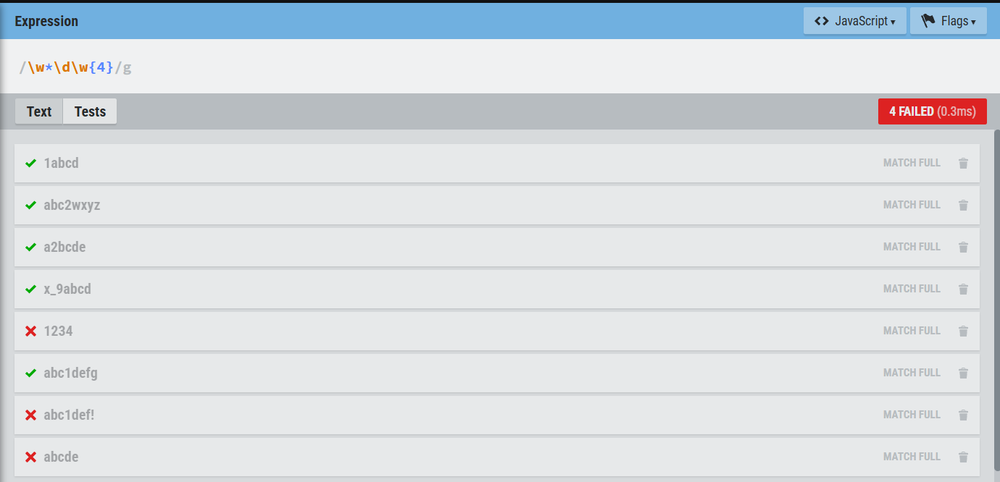
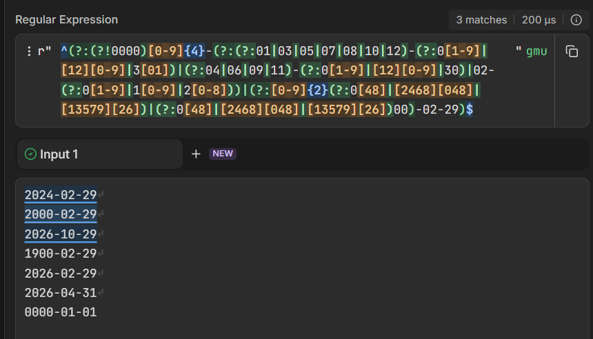
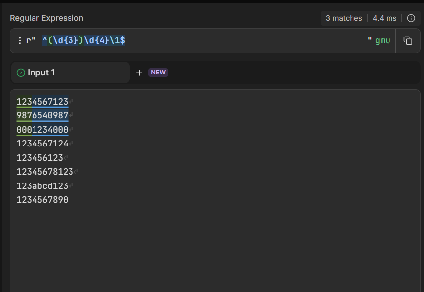
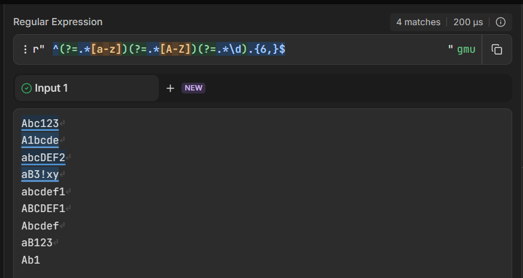

### Name: TEK Chansetha
### ID: e20220186
### Course: NLP
### Lecturer: DR. VALY Dona
---

# RE Exercises


## Write a regular expression to match each of the following patterns:
### 1. Any character that is not a word character nor a white space

```re
[^\w\s]
```



### 2. String of letters whose length is at most 3

```re
[A-Za-z]{0,3}
```



### 3. String of digits whose length is at least 3 
```re
\d{3,}
```



### 4. String of word characters containing at least one a and one b 
```re
(?=\w*a)(?=\w*b)\w+
```



### 5. Anything enclosed by square brackets
```re
\[[^\[\]]*\]
```



### 6. String of word characters whose the 5thcharacter from the right end is a digit
```re
\w*\d\w{4}
```



### 7. Date format: yyyy-mm-dd
```re
^(?:(?!0000)[0-9]{4}-(?:(?:01|03|05|07|08|10|12)-(?:0[1-9]|[12][0-9]|3[01])|(?:04|06|09|11)-(?:0[1-9]|[12][0-9]|30)|02-(?:0[1-9]|1[0-9]|2[0-8]))|(?:[0-9]{2}(?:0[48]|[2468][048]|[13579][26])|(?:0[48]|[2468][048]|[13579][26])00)-02-29)$
```



### 8. String of 10 digits that starts and ends with the same 3 digit sequence

```re
^(\d{3})\d{4}\1$
```


### 9. Password satisfying the following conditions:
   - at least 1 lowercase letter
   - at least 1 uppercase letter
   - at least 1 digit
   - six characters or more


```re
^(?=.*[a-z])(?=.*[A-Z])(?=.*\d).{6,}$
```

